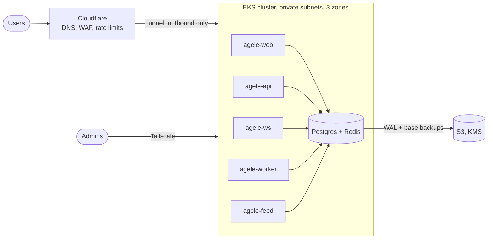

# agele-infra

Production infrastructure for [Agele](https://github.com/jog01/agele): Kubernetes with Helm, Cloudflare in front, Tailscale for admin access, Terraform for everything outside the cluster. Nothing is deployed yet. [docs/go-live.md](docs/go-live.md) is the path to production.



| | |
|---|---|
| Cluster | EKS 1.34, managed Bottlerocket nodes across 3 zones ([GKE notes](docs/gke.md)) |
| Public traffic | Cloudflare Tunnel only; no public load balancer or node ports |
| Admin access | Tailscale: kubectl, Argo CD, Grafana, psql |
| Postgres | CloudNativePG, 3 instances, sync replication, TLS 1.3 only, PITR backups to S3 |
| Redis | StatefulSet with AOF, auth and `noeviction` for BullMQ |
| Secrets | Bitwarden Secrets Manager synced by External Secrets |
| Delivery | Argo CD app-of-apps, images from GHCR |
| IaC | Terraform: AWS, Cloudflare, Tailscale |

## Layout

| Path | What |
|---|---|
| [`charts/agele`](charts/agele) | api, ws, worker, feed, web, migration Job, cloudflared, NetworkPolicies, HPAs, PDBs |
| [`charts/agele-data`](charts/agele-data) | CloudNativePG cluster, backups, Redis, data NetworkPolicies |
| [`charts/platform-config`](charts/platform-config) | Encrypted StorageClass, Bitwarden store, Tailscale operator secret, tailnet ingresses |
| [`charts/argocd-apps`](charts/argocd-apps) | One Argo CD Application per component, in sync-wave order |
| [`platform/`](platform) | Values for the upstream operators (cert-manager, External Secrets, CloudNativePG, Tailscale, monitoring, Argo CD) |
| [`environments/`](environments) | `staging` and `production` values for every chart |
| [`bootstrap/`](bootstrap) | Root Argo CD Application per environment |
| [`terraform/`](terraform) | `global` (Cloudflare zone, Tailscale ACL) and `envs/<env>` (VPC, EKS, KMS, S3, tunnel) |

## Docs

- [Architecture](docs/architecture.md): components, traffic, data, secrets and delivery, with diagrams
- [Go-live](docs/go-live.md): every step from an empty AWS account to production
- [Operations](docs/operations.md): deploys, rollbacks, restores, rotation, scaling
- [Security](docs/security.md): how the database compares to RDS and what each boundary enforces
- [GKE](docs/gke.md): what changes on Google Cloud

## Checks

CI runs on every PR ([validate.yml](.github/workflows/validate.yml)): `helm lint`, `helm template` for both environments, `kubeconform` against Kubernetes 1.34 and CRD schemas, `terraform fmt` and `terraform validate`. Locally:

```bash
make check
```
