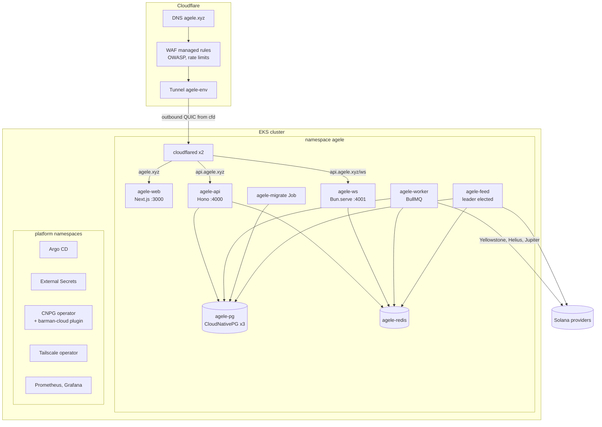
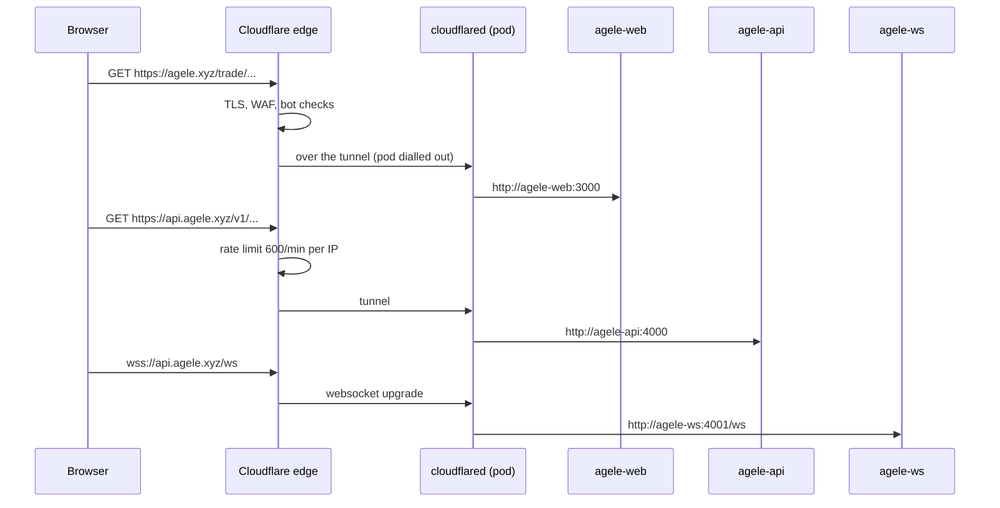
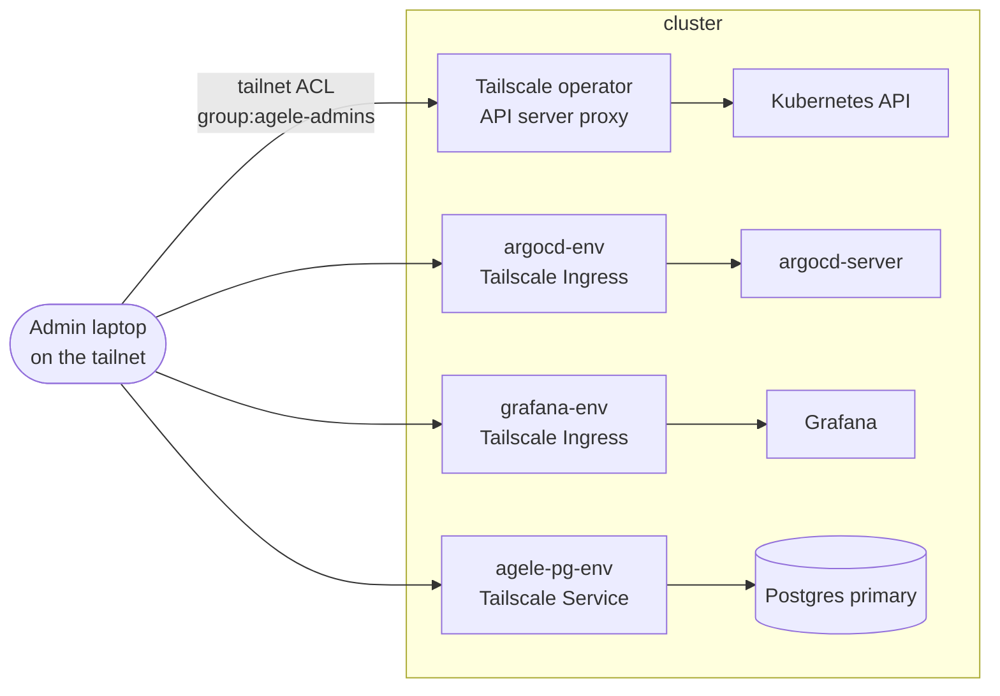
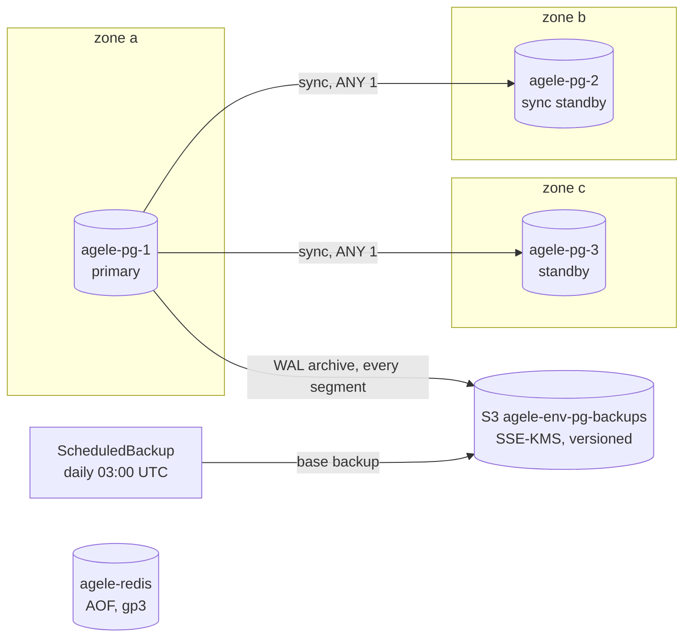
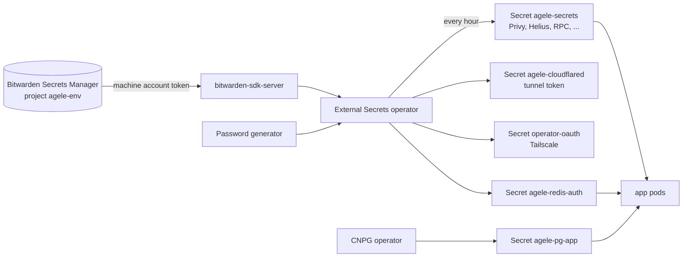
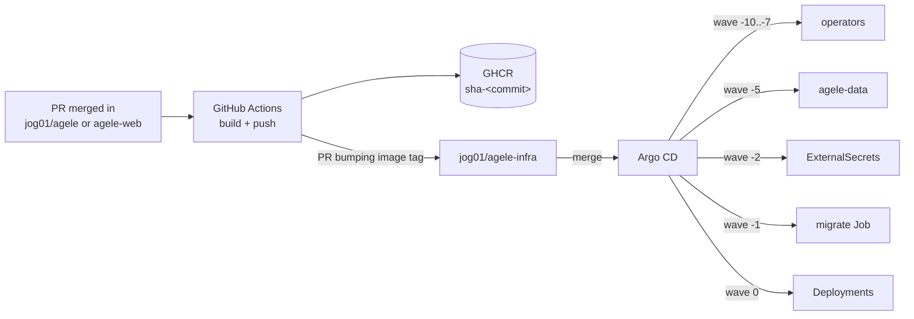

# Architecture

Agele runs as five workloads on one Kubernetes cluster per environment, with Postgres and Redis in the same cluster. Cloudflare is the only public entry point and Tailscale is the only admin entry point. Terraform owns everything outside the cluster; Argo CD owns everything inside it.

## Environments

| | staging | production |
|---|---|---|
| Web | `staging.agele.xyz` | `agele.xyz`, `www.agele.xyz` |
| API and websocket | `api.staging.agele.xyz`, `/ws` | `api.agele.xyz`, `/ws` |
| Cluster | `agele-staging` (own VPC `10.1.0.0/16`) | `agele-production` (own VPC `10.0.0.0/16`) |
| NAT gateways | 1 | 1 per zone |
| Postgres | 2 instances, 20 Gi, 7-day backups | 3 instances, 50 Gi, 30-day backups |
| App replicas (min) | 1 | 2 |
| Bitwarden project | `agele-staging` | `agele-production` |

Separate clusters and VPCs: a bad change or leaked credential in staging cannot reach production data.

## Components

| Workload | Image | Scales | Notes |
|---|---|---|---|
| `agele-api` | `ghcr.io/jog01/agele-api` | HPA 2-10 on CPU | REST `/v1`, Helius webhooks, `/health` |
| `agele-ws` | `ghcr.io/jog01/agele-ws` | HPA 2-10 on CPU | Websocket `/ws`, fans out Redis pub/sub |
| `agele-worker` | `ghcr.io/jog01/agele-worker` | HPA 2-8 on CPU | BullMQ: trade index, portfolio snapshots, leaderboards |
| `agele-feed` | `ghcr.io/jog01/agele-feed` | fixed 2 | Holds a Redis lease; the standby takes over in 15 s |
| `agele-web` | `ghcr.io/jog01/agele-web` | HPA 2-10 on CPU | One image per environment (`NEXT_PUBLIC_*` is build-time) |
| `agele-migrate` | api image | per sync | `bun src/db/migrate.ts`, runs before Deployments roll |
| `agele-cloudflared` | `cloudflare/cloudflared` | fixed 2 | Tunnel connector, token from Bitwarden |

Every pod runs as non-root with a read-only root filesystem, no service account token, all capabilities dropped and the `RuntimeDefault` seccomp profile. Pods spread across the three zones.

## Public request path

- The cluster has no public load balancer, ingress controller or node port. `cloudflared` dials out to Cloudflare; nothing dials in.
- A NetworkPolicy lets only `cloudflared` (and Prometheus) reach web, api and ws. Everything else in the namespace is default-deny.
- Hostnames and path routes live in Terraform ([`terraform/modules/cloudflare-tunnel`](../terraform/modules/cloudflare-tunnel/main.tf)), not in the cluster.

## Admin path

| What | How |
|---|---|
| kubectl | `tailscale configure kubeconfig k8s-<env>`; the operator proxies to the API server with impersonation |
| Argo CD | `https://argocd-<env>.<tailnet>.ts.net` |
| Grafana | `https://grafana-<env>.<tailnet>.ts.net` |
| psql | `psql "host=agele-pg-<env> sslmode=verify-full ..."` over the tailnet |

The EKS public endpoint exists only for bootstrap, limited to operator IPs, and is turned off once the Tailscale proxy works ([go-live step 9](go-live.md#9-close-the-public-api-endpoint)). The [tailnet policy](../terraform/global/tailscale.tf) grants these four ports to `group:agele-admins` and nothing else.

## Data

**Postgres** (CloudNativePG, [`charts/agele-data`](../charts/agele-data)):
- Three instances, one per zone, on KMS-encrypted gp3. A commit waits for one standby (`ANY 1`, `dataDurability: required`), so a lost zone loses no committed data.
- The operator fails over automatically; the `agele-pg-rw` Service always points at the primary.
- TLS 1.3 only; `pg_hba` rejects every non-TLS connection. Passwords use SCRAM. The superuser is disabled.
- WAL streams to S3 continuously and a base backup runs daily, so any point in the retention window can be restored ([operations](operations.md#restore-postgres-to-a-point-in-time)).
- The app user and password are generated by the operator into `agele-pg-app`; nobody types them.

**Redis**: one StatefulSet pod with AOF (`everysec`) on encrypted gp3, a generated password, `noeviction` (BullMQ breaks under eviction) and `FLUSHALL`, `FLUSHDB` and `DEBUG` disabled. Redis holds queues, pub/sub, leaderboards and the feed lease. Postgres is the source of truth, so losing Redis loses in-flight jobs, not records; leaderboards rebuild from Postgres.

## Secrets

- One manual secret per cluster: the Bitwarden machine-account token, created once at bootstrap. Everything else flows from Bitwarden or is generated in the cluster.
- Kubernetes Secrets are envelope-encrypted in etcd with a customer-managed KMS key.
- Each environment has its own Bitwarden project and machine account, so staging cannot read production secrets.
- Secret names in Bitwarden match the env var names (`PRIVY_APP_SECRET`, ...). The list is `secrets.keys` in [`charts/agele/values.yaml`](../charts/agele/values.yaml).

## Delivery

- Images are tagged by commit SHA; tags never move. Production runs exactly what is in `environments/production/agele.yaml`.
- Argo CD syncs automatically with self-heal and prune, so a change made by hand in the cluster is reverted. Git is the only way to change production.
- The migration Job runs on every sync after secrets and before Deployments; a failed migration stops the rollout.
- Rollouts are surge-only (`maxUnavailable: 0`) and gated on `/health` readiness.

## Observability

kube-prometheus-stack scrapes the nodes, Kubernetes, CloudNativePG (PodMonitor and its Grafana dashboard), cert-manager and External Secrets. The backend exports OpenTelemetry traces when `OTEL_EXPORTER_OTLP_ENDPOINT` is set; no collector is chosen yet ([open decisions](go-live.md#open-decisions)).

## Failure modes

| Failure | Effect | Recovery |
|---|---|---|
| One node | Pods reschedule; PDBs keep one replica of each up | Automatic |
| One zone | Postgres promotes a standby in another zone; no committed data lost | Automatic, about 30 s |
| Postgres primary pod | Switchover to a sync standby | Automatic |
| Redis pod | Queues pause until it restarts with its AOF | Automatic, seconds |
| Feed leader | Standby takes the lease after 15 s | Automatic |
| Cloudflare Tunnel connector | Other replica carries traffic | Automatic |
| Region or cluster | Rebuild from Terraform + Argo CD, restore Postgres from S3 | [Runbook](operations.md#rebuild-a-cluster) |
| Bad deploy | Argo CD stops at the failed wave | Revert the tag bump PR |
