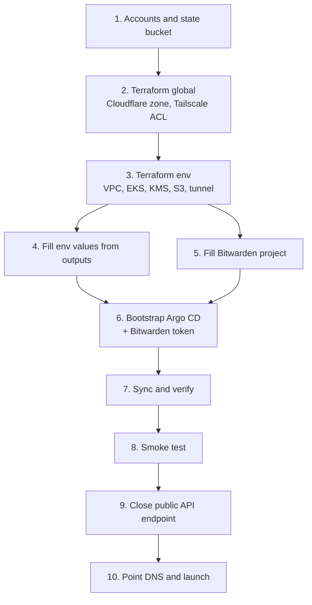

# Go-live

From empty accounts to production, in order. Do staging end to end first, then repeat steps 3-10 for production. Every step lists what it produces, so a later step never needs something that does not exist yet.



## Prerequisites

| Tool | Version |
|---|---|
| Terraform | 1.10+ (S3 native locking) |
| Helm | 3.17+ |
| kubectl | within one minor of the cluster |
| AWS CLI | v2, with an admin role for the target account |
| Tailscale | on the admin laptop, logged in to the tailnet |

## 1. Accounts and state bucket

1. **AWS**: one account per environment is best (AWS Organizations); one account with both is fine to start. Create an admin IAM role you assume for Terraform. On a fresh account, create the Auto Scaling service-linked role, which the nodes' KMS grant names (an "already exists" error is fine):
   ```bash
   aws iam create-service-linked-role --aws-service-name autoscaling.amazonaws.com
   ```
2. **Cloudflare**: add `agele.xyz` as a zone and change the registrar's nameservers to Cloudflare's. Create an API token with *Zone: DNS Edit, Zone WAF Edit, Zone Settings Edit* on `agele.xyz` and *Account: Cloudflare Tunnel Edit*. Note the account ID.
3. **Tailscale**: create the tailnet (or use the existing one). Create an OAuth client for Terraform with the `policy_file` and `oauth_keys` scopes.
4. **Bitwarden**: enable Secrets Manager on the organization. Create projects `agele-staging` and `agele-production`, and one machine account per project with read access to only that project.
5. **State bucket**, once:
   ```bash
   aws s3api create-bucket --bucket agele-terraform-state --region us-east-1
   aws s3api put-bucket-versioning --bucket agele-terraform-state --versioning-configuration Status=Enabled
   aws s3api put-public-access-block --bucket agele-terraform-state \
     --public-access-block-configuration BlockPublicAcls=true,IgnorePublicAcls=true,BlockPublicPolicy=true,RestrictPublicBuckets=true
   cp terraform/backend.hcl.example terraform/backend.hcl
   ```

## 2. Terraform global

Cloudflare zone settings (strict TLS, HTTPS only, WAF managed rules, rate limits) and the tailnet policy with one Tailscale operator OAuth client per environment.

```bash
cd terraform/global
cp terraform.tfvars.example terraform.tfvars   # tailnet, admins
export CLOUDFLARE_API_TOKEN=... TAILSCALE_OAUTH_CLIENT_ID=... TAILSCALE_OAUTH_CLIENT_SECRET=...
terraform init -backend-config=../backend.hcl -backend-config="key=global/terraform.tfstate"
terraform apply
terraform output -json operator_oauth_client_secrets
```

**Produces**: Tailscale operator client id and secret per environment.

## 3. Terraform environment

```bash
cd terraform/envs/staging
cp terraform.tfvars.example terraform.tfvars   # Cloudflare account id, admin role ARN, your IP
terraform init -backend-config=../../backend.hcl -backend-config="key=staging/terraform.tfstate"
terraform apply          # about 20 minutes
terraform output
terraform output -raw tunnel_token
aws eks update-kubeconfig --name agele-staging --region us-east-1
```

**Produces**: the cluster, `ebs_kms_key_arn`, `pg_backup_destination`, `tunnel_token`. The tunnel's DNS records exist but return errors until `cloudflared` runs in step 7.

## 4. Fill environment values

In `environments/staging/` (open a PR; Argo CD reads `main`):

| File | Key | Value |
|---|---|---|
| `platform-config.yaml` | `storageClass.kmsKeyId` | `ebs_kms_key_arn` |
| `platform-config.yaml` | `bitwarden.organizationID`, `bitwarden.projectID` | Bitwarden organization and `agele-staging` project ids |
| `agele-data.yaml` | `postgres.backup.destinationPath` | `pg_backup_destination` |
| `agele.yaml` | `image.backendTag`, `image.webTag` | The first images published from `jog01/agele` and `jog01/agele-web` |

## 5. Fill the Bitwarden project

Create these secrets in `agele-staging` (names are exact; values from each provider's dashboard):

| Secret | Source |
|---|---|
| `CLOUDFLARE_TUNNEL_TOKEN` | `terraform output -raw tunnel_token` (step 3) |
| `TAILSCALE_OPERATOR_CLIENT_ID`, `TAILSCALE_OPERATOR_CLIENT_SECRET` | Step 2 outputs for this environment |
| `SOLANA_RPC_URL` | Helius or another RPC provider, with key |
| `PRIVY_APP_ID`, `PRIVY_APP_SECRET`, `PRIVY_VERIFICATION_KEY` | dashboard.privy.io, one app per environment |
| `HELIUS_API_KEY`, `HELIUS_WEBHOOK_SECRET` | Helius dashboard |
| `YELLOWSTONE_GRPC_URL`, `YELLOWSTONE_GRPC_TOKEN` | Yellowstone gRPC provider |
| `JUPITER_API_KEY` | portal.jup.ag |
| `BIRDEYE_API_KEY` | Birdeye |

Optional values left empty can be omitted from the list in `secrets.keys` instead. Never set `FEE_PAYER_SECRET` in staging or production; the backend refuses to start with it outside development.

## 6. Bootstrap Argo CD

The only manual `kubectl` in the whole process. After this, Argo CD manages itself and everything else from git.

```bash
kubectl create namespace external-secrets
kubectl -n external-secrets create secret generic bitwarden-access-token \
  --from-literal=token='<agele-staging machine account access token>'

helm repo add argo https://argoproj.github.io/argo-helm
# First set TAILNET in environments/staging/platform/argo-cd.yaml (your tailnet's ts.net name).
helm install argocd argo/argo-cd --version 10.20.0 -n argocd --create-namespace \
  -f platform/argo-cd.yaml -f environments/staging/platform/argo-cd.yaml
kubectl apply -f bootstrap/staging.yaml
```

## 7. Sync and verify

Argo CD syncs in waves: operators, then cluster config, then data, then the app. Watch it:

```bash
kubectl -n argocd get applications -w
kubectl -n agele get cluster,pods,externalsecrets
```

Done when:
- every Application is `Synced` and `Healthy`;
- `kubectl -n agele get cluster agele-pg` shows `Cluster in healthy state` with all instances ready;
- `kubectl -n agele get backup` shows the first backup `completed` (trigger one with `kubectl cnpg backup agele-pg -n agele`);
- every ExternalSecret is `SecretSynced`;
- the `agele-migrate` Job completed.

## 8. Smoke test

```bash
curl -s https://staging-api.agele.xyz/health            # {"status":"ok",...}
websocat wss://staging-api.agele.xyz/ws                 # connects, receives heartbeats
open https://staging.agele.xyz
```

Then point the Helius webhook at `https://staging-api.agele.xyz/v1/webhooks/helius` (`bun run helius:sync` in `jog01/agele` with the staging key), sign in with Privy, place a small trade and check it shows in the portfolio.

Also check what must fail:
- `curl https://staging-api.agele.xyz/health` from a script in a loop past 600 requests a minute returns `429`;
- `psql "host=<anything public> ..."` has nothing to connect to; Postgres is only on the tailnet.

## 9. Close the public API endpoint

```bash
tailscale configure kubeconfig k8s-staging
kubectl get nodes                                         # works over the tailnet
cd terraform/envs/staging && terraform apply -var endpoint_public_access=false
```

From now on `kubectl` only works on the tailnet.

## 10. Point DNS and launch

For production, repeat steps 3-9 with `envs/production` and `environments/production`. The production tunnel creates the `agele.xyz`, `www.agele.xyz` (redirected to the apex at the edge) and `api.agele.xyz` records, so production goes live when its `cloudflared` connects. Before that:

- [ ] Staging ran for at least a week with no manual changes.
- [ ] A point-in-time restore was rehearsed on staging ([operations](operations.md#restore-postgres-to-a-point-in-time)).
- [ ] Argo CD SSO (GitHub OIDC under `dex.config` in `platform/argo-cd.yaml`) is on; the local admin is disabled already.
- [ ] Alert routes in Alertmanager go somewhere a person reads (Slack `#error-logs`).
- [ ] Privy production app allows only `https://agele.xyz`.
- [ ] Browser RPC key (`NEXT_PUBLIC_SOLANA_RPC_URL`) is restricted to `agele.xyz`.
- [ ] Helius production webhook points at `https://api.agele.xyz/v1/webhooks/helius`.

## Open decisions

None of these block go-live; each has a default in the repo.

| Decision | Default here | Change when |
|---|---|---|
| Cloud | EKS in `us-east-1` | GKE: see [gke.md](gke.md) |
| Tracing backend | None; set `OTEL_EXPORTER_OTLP_ENDPOINT` | A collector or vendor is picked |
| Image bumps | Publish workflow opens a PR here per merge | Argo CD Image Updater for staging auto-deploys |
| Redis HA | Single pod with AOF | Queue loss during a node failure becomes unacceptable: Redis Sentinel or ElastiCache |
| Node autoscaling | Managed node group, fixed min | Load varies: add Karpenter |
