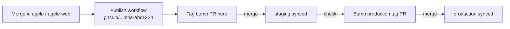
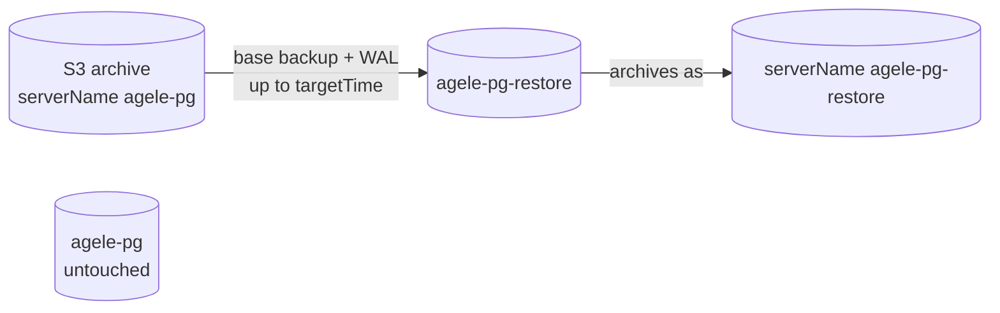
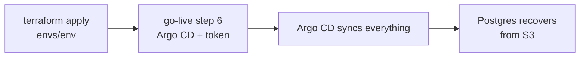

# Operations

Every change goes through a PR to this repo; Argo CD applies `main`. `kubectl` (over Tailscale) is for reading and for the emergency steps below.

## Deploy a new version



1. The publish workflow in `jog01/agele` or `jog01/agele-web` pushes `sha-<commit>` images.
2. Bump `image.backendTag` or `image.webTag` in `environments/staging/agele.yaml`, merge.
3. Argo CD runs `agele-migrate`, then rolls the Deployments. Check `https://staging-api.agele.xyz/health`.
4. Same bump in `environments/production/agele.yaml`.

Migrations must stay backward compatible with the previous release (add columns before using them, drop them a release later), because old pods serve while new ones start.

## Roll back

Revert the tag bump PR. The previous images are still in GHCR. A migration is not reverted automatically: if it must be, ship a new forward migration.

## Restore Postgres to a point in time

CloudNativePG restores by bootstrapping a new cluster from the S3 archive. `charts/agele-data` does this with `postgres.recovery`.



**Side by side** (a bad write; the old cluster stays up for comparison):

```bash
helm template restore charts/agele-data -n agele -f environments/production/agele-data.yaml \
  --set postgres.name=agele-pg-restore \
  --set postgres.recovery.enabled=true \
  --set postgres.recovery.serverName=agele-pg \
  --set postgres.recovery.objectStore=agele-pg-backups \
  --set postgres.recovery.targetTime="2027-01-15 10:24:00+00" \
  --show-only templates/postgres-cluster.yaml --show-only templates/postgres-backups.yaml \
  | kubectl apply -n agele -f -
kubectl cnpg status agele-pg-restore -n agele
```

Check the data with `psql` over the tailnet. To switch, set `postgres.appSecret: agele-pg-restore-app` and the `DATABASE_URL` host in a PR, or copy the rows back to `agele-pg` if only some were lost.

**In place** (cluster rebuild): in `environments/<env>/agele-data.yaml` set `postgres.recovery.enabled: true`, `postgres.recovery.serverName: agele-pg` and `postgres.backup.serverName: agele-pg-r1`, so the new cluster never archives on top of the one it restores from. Remove `recovery` after the first base backup of the new cluster completes; the cluster only reads it at bootstrap.

Rehearse on staging before production launches and once a quarter after.

## Rebuild a cluster



The S3 backups, Bitwarden and Cloudflare outlive the cluster. Run [go-live](go-live.md) steps 3, 6 and 7 with the Postgres recovery block set, so the new cluster starts from the latest WAL.

## Rotate secrets

| Secret | How |
|---|---|
| Anything in Bitwarden | Change it in Bitwarden. External Secrets picks it up within an hour (`kubectl annotate externalsecret agele-secrets force-sync=$(date +%s) -n agele` for now), then restart the Deployments that read it: `kubectl -n agele rollout restart deploy` |
| Postgres app password | `kubectl cnpg` cannot rotate it in place; delete `agele-pg-app` and the operator regenerates it, then restart the app |
| Redis password | Delete `agele-redis-auth`; External Secrets generates a new one; restart Redis and the app |
| Tunnel token | `terraform apply -replace=module.tunnel.cloudflare_zero_trust_tunnel_cloudflared.this`, then update Bitwarden |
| Bitwarden machine token | New token in Bitwarden, replace `bitwarden-access-token` in `external-secrets` |

## Scale

- App workloads scale with the HPAs; change `components.<name>.autoscaling` per environment.
- Nodes: raise `node_max_size` / `node_min_size` in Terraform.
- Postgres: raise `postgres.storage.size` (online expansion), `postgres.resources` (rolling restart with switchover), or `postgres.instances`.
- `max_connections` is 200: with 2-10 api pods, 2-8 workers and 2 feeds, keep each pod's pool small or add PgBouncer (`Pooler` resource in CloudNativePG).

## Upgrade

- **Operators**: bump the version in `charts/argocd-apps/values.yaml`, read the upstream changelog, staging first.
- **Postgres minor**: bump `postgres.image`; the operator restarts standbys, then switches over.
- **Postgres major**: new cluster with `bootstrap.initdb.import` from the old one, then switch.
- **Kubernetes**: bump `kubernetes_version` one minor at a time, staging first.

## Useful commands

```bash
kubectl -n argocd get applications
kubectl cnpg status agele-pg -n agele
kubectl cnpg backup agele-pg -n agele
kubectl -n agele logs deploy/agele-api -f
kubectl -n agele get externalsecrets
psql "host=agele-pg-<env> user=agele dbname=agele sslmode=require"
```
